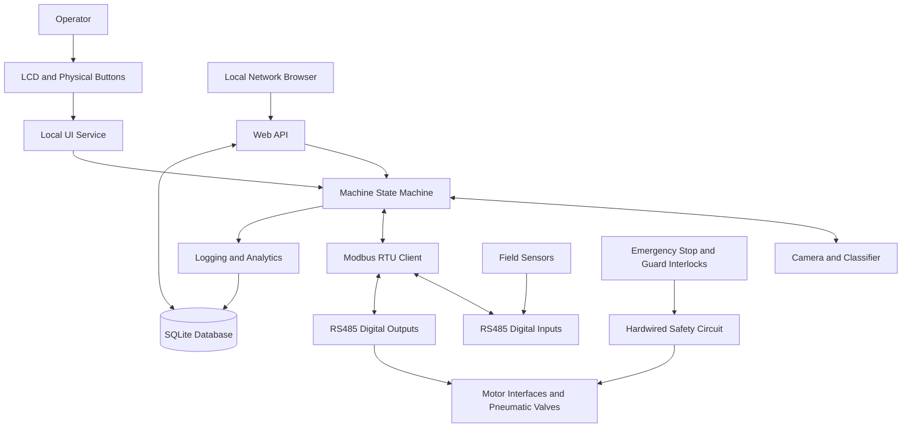
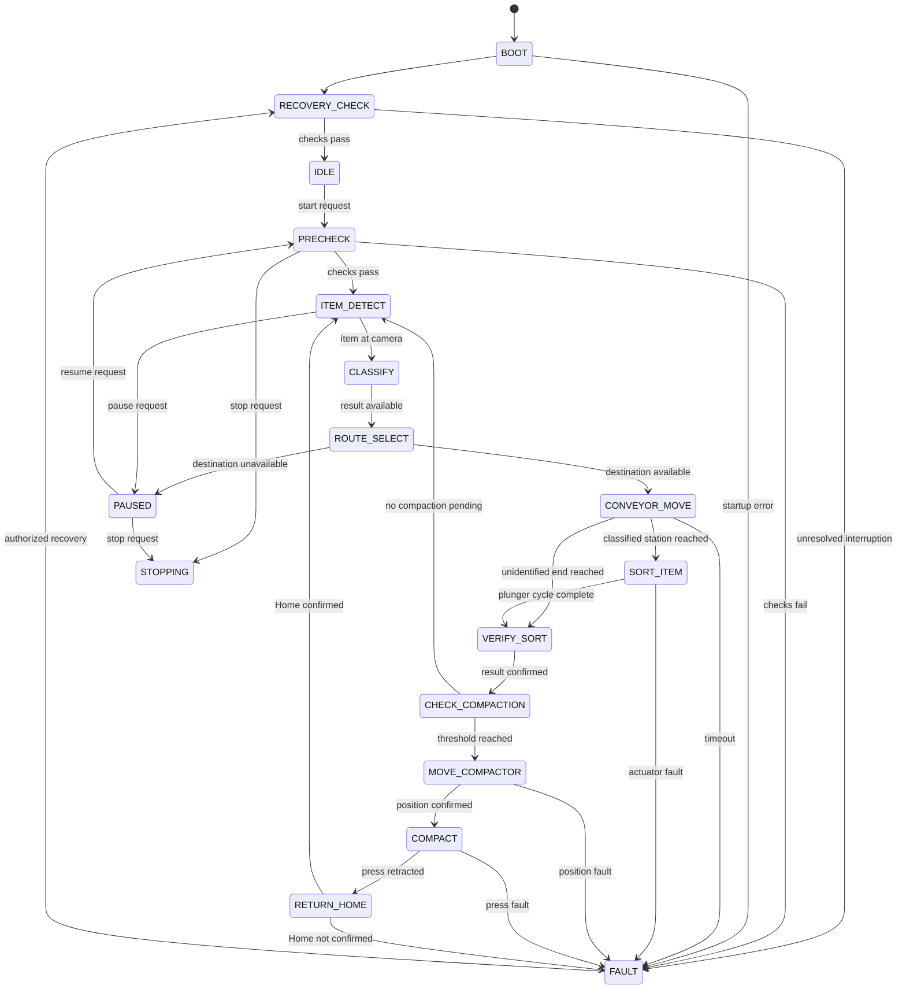

# 03 - System Architecture
## Garbage Sorting and Compaction Machine

**Document ID:** ARCH-001  
**Version:** 1.0  
**Status:** Prototype baseline

## 1. Architecture Goals

- Keep machine sequencing deterministic and testable.
- Separate application software from safety functions.
- Isolate hardware-specific code behind interfaces.
- Support local controls and a local-network dashboard.
- Record machine activity for troubleshooting and analytics.
- Support simulation before live actuator integration.

## 2. High-Level Architecture

The safety circuit must inhibit hazardous motion independently of normal Raspberry Pi application logic.

## 3. Hardware Architecture

### 3.1 Main Controller

The Raspberry Pi 4 Model B hosts:

- Machine state machine.
- Camera capture and classification.
- Modbus communications.
- LCD and button handling.
- Web API and dashboard.
- SQLite persistence.
- CSV export and analytics.
- Diagnostics and event logging.

Use a stable power supply, adequate cooling, reliable storage, and controlled startup/shutdown.

### 3.2 Field I/O

Remote I/O modules read sensors and command actuator interfaces over RS485 Modbus RTU.

Preliminary estimate:

- Up to 28 digital inputs, depending on final feedback requirements.
- 13 digital outputs.

Select modules based on electrical ratings, isolation, channel count, watchdog behavior, environment, and available spare channels.

### 3.3 Motion and Pneumatics

- The conveyor runs through a suitable motor starter or drive.
- The lead-screw carriage uses an AC motor with an interlocked reversing interface.
- Four sensors confirm carriage positions.
- Three sorting plungers use single-acting spring-return cylinders.
- The compaction press uses one single-acting spring-return cylinder.
- Three bin ejectors use single-acting spring-return cylinders.
- Each cylinder is assumed to use one suitable 3/2 solenoid valve.
- Required return positions and air pressure are monitored.

### 3.4 Safety Layer

The safety layer includes components selected through a machine-specific risk assessment:

- Emergency stop.
- Guard/door interlocks.
- Suitable safety relay or safety controller.
- Motor contactor or drive safety function.
- Overload and short-circuit protection.
- Pneumatic isolation and exhaust provisions.
- Prevention of unexpected restart.

A Raspberry Pi, standard Modbus module, or dashboard button is not a substitute for a safety-rated function.

## 4. Software Layers

### 4.1 Presentation Layer

- LCD and physical buttons.
- Local-network dashboard.
- Status, counts, bin availability, alarms, and recent events.
- Validated operator commands.

Presentation handlers must not write hardware outputs directly.

### 4.2 Application Layer

- State machine.
- Command validation.
- Interlock evaluation.
- Recovery coordinator.
- Fault manager.
- Cycle coordinator.

All automatic and manual requests pass through this layer.

### 4.3 Service Layer

- Item tracking.
- Classification result handling.
- Bin management.
- Compaction scheduling.
- Ejector/service sequences.
- Event logging.
- Analytics and CSV export.
- Settings validation.

### 4.4 Hardware Abstraction Layer

- Modbus client.
- I/O mapping.
- Conveyor interface.
- Carriage motor interface.
- Pneumatic valve interface.
- Sensor readers.
- Camera interface.

Hardware drivers expose commands and feedback. They do not own the full machine sequence.

### 4.5 Persistence Layer

SQLite stores:

- Items.
- Bin state.
- Compaction cycles.
- Ejector/service cycles.
- Machine events.
- Fault events.
- Settings.
- Diagnostic snapshots.

Use a repository layer so application logic does not depend directly on SQL statements.

## 5. Operating State Machine

The diagram is a design baseline. Define the permitted transitions, stop behavior, and recovery conditions in code and test them.

## 6. Key Sequence Rules

### 6.1 Item Handling

- Process one tracked item at a time.
- Assign an item ID before committing classification.
- Do not move an item from the camera station before receiving a valid classification or failure result.
- Route low-confidence items to unidentified only when item tracking and route conditions remain valid.
- Do not route to a full or unavailable bin.
- Define a safe response if a bin becomes full while an item is already in transit.

### 6.2 Sorting

- Confirm the destination station before extending a plunger.
- Energize only the selected sorting valve.
- Confirm required return feedback before moving the conveyor again.
- Stop sequence progression if a movement times out.

### 6.3 Compaction

1. Select the bin with pending compaction.
2. Confirm safety status, air pressure, and press retraction.
3. Confirm the carriage position sensors are valid.
4. Move the carriage to the target bin.
5. Confirm the target position.
6. Extend the press.
7. Retract the press and confirm its retracted position.
8. Return the carriage to Home.
9. Confirm Home before resuming sorting.
10. Record the cycle result and duration.

Preserve the pending status and item count after a failed cycle. Reset counts only after the agreed successful-compaction condition is met.

### 6.4 Bin Service

- A full signal marks the bin unavailable.
- Run the service/ejector sequence only under validated conditions.
- Confirm completion through feedback or an explicit manual confirmation process.
- Mark the bin available only after its availability criteria are satisfied.
- The unidentified bin has no ejector in the initial scope.

## 7. Communication Design

- One Modbus service owns serial-port access.
- Poll at a controlled rate.
- Timestamp input snapshots and detect stale feedback.
- Serialize requests on a shared bus.
- Use bounded timeouts.
- Do not blindly retry actuator commands.
- After communication loss, inhibit new motion and require a recovery check.
- Test remote I/O behavior during bus loss.

## 8. Data Flow

1. Read and timestamp sensor inputs.
2. Check sensor freshness and operating preconditions.
3. Capture and classify the item.
4. Select a destination.
5. Command movement through hardware interfaces.
6. Verify feedback or raise a timeout fault.
7. Commit the item result and counters to the database.
8. Update LCD and dashboard status.
9. Provide analytics and CSV export from persisted records.

## 9. Security

- Bind the dashboard to the intended local interface.
- Do not expose the service to the public internet by default.
- Validate commands and configuration values.
- Restrict maintenance and administrative functions.
- Keep credentials out of source control.
- Record state-changing commands and their results where user identity is available.

## 10. Deployment

- Raspberry Pi OS 64-bit.
- Python virtual environment with tested dependency versions.
- Configuration separate from source code.
- SQLite database and image files in designated data directories.
- systemd service for startup and controlled restart behavior.
- Log rotation to prevent storage exhaustion.
- Documented backup and export procedures.
