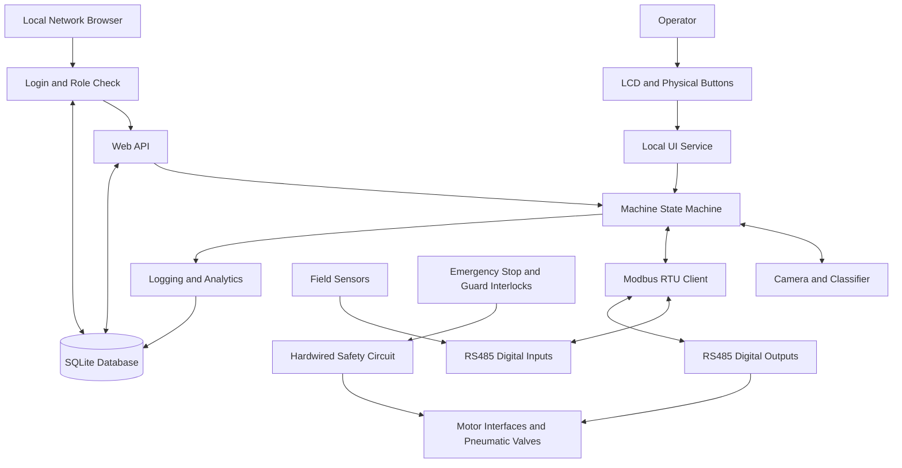
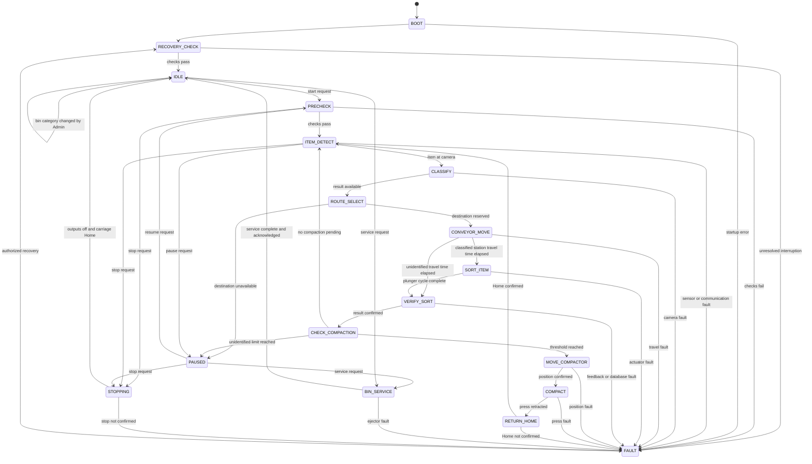
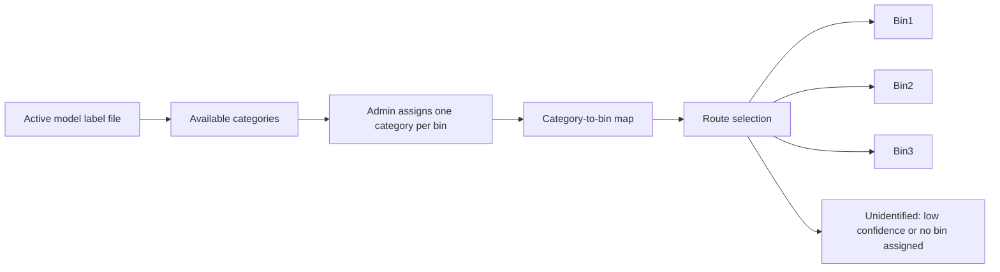

# 03 - System Architecture
## Garbage Sorting and Compaction Machine

**Document ID:** ARCH-001  
**Version:** 1.4  
**Status:** Final

## 1. Architecture Goals

- Keep machine sequencing deterministic and testable.
- Separate application software from safety functions.
- Isolate hardware-specific code behind interfaces.
- Support local controls and a login-protected local-network dashboard with role-based access.
- Keep hardware named by bin position so bin categories can be changed in settings.
- Record machine activity for troubleshooting and analytics.
- Support simulation before live actuator integration.

## 2. High-Level Architecture

The safety circuit must inhibit hazardous motion independently of normal Raspberry Pi application logic.

## 3. Hardware Architecture

### 3.1 Main Controller

The Raspberry Pi 4 Model B hosts:

- Machine state machine.
- Camera capture and TensorFlow Lite classification.
- Modbus communications.
- LCD and button handling.
- Web API and dashboard, with login and role checks.
- SQLite persistence.
- CSV export and analytics.
- Diagnostics and event logging.

Use a stable power supply, adequate cooling, reliable storage, and controlled startup/shutdown.

### 3.2 Field I/O

Remote I/O modules read sensors and command actuator interfaces over RS485 Modbus RTU.

I/O count:

- 15 digital inputs.
- 13 digital outputs.

Air pressure, safety-circuit status, guard status, conveyor drive healthy, and motor overload are hardwired and are not Modbus inputs.

Select modules based on electrical ratings, isolation, channel count, watchdog behavior, environment, and available spare channels.

### 3.3 Motion and Pneumatics

- The conveyor runs through a suitable motor starter or drive and is positioned by calibrated travel times from the camera-station item sensor.
- The lead-screw carriage uses an AC motor with an interlocked reversing interface.
- Four sensors confirm the carriage positions Home, Bin 1, Bin 2, and Bin 3.
- Three sorting plungers, one per bin, use single-acting spring-return cylinders.
- The compaction press uses one single-acting spring-return cylinder with a retracted sensor only.
- Three bin ejectors use single-acting spring-return cylinders to push compacted blocks into a collection tray or bag.
- Each cylinder is assumed to use one suitable 3/2 solenoid valve.
- Required return positions are monitored by Modbus inputs. Air pressure and motor protection are hardwired.

### 3.4 Safety Layer

The safety layer includes components selected through a machine-specific risk assessment:

- Emergency stop.
- Guard/door interlocks.
- Suitable safety relay or safety controller.
- Motor contactor or drive safety function.
- Overload and short-circuit protection.
- Pneumatic isolation and exhaust provisions.
- Prevention of unexpected restart.

A Raspberry Pi, standard Modbus module, or dashboard button is not a substitute for a safety-rated function.

## 4. Software Layers

### 4.1 Presentation Layer

- LCD and physical buttons.
- Local-network dashboard.
- Login, logout, and session handling.
- Role checks for every page and API endpoint.
- Status, counts, bin categories, bin availability, alarms, and recent events.
- Validated operator commands.
- Admin pages for settings, bin categories, users, and maintenance.

Presentation handlers must not write hardware outputs directly.

#### 4.1.1 Roles

| Role | Permitted |
|---|---|
| Viewer | Status, counts, bins, items, events, faults, analytics, and CSV export |
| Operator | Viewer permissions, plus start, pause, stop, fault acknowledgement, bin service and acknowledgement, and unidentified-bin reset |
| Admin | Operator permissions, plus all settings, bin category assignment, active model selection, user management, maintenance mode, I/O tests, and recovery |

Roles are checked on the server for every request. Hiding a button in the browser is not access control.

The LCD and physical buttons need no login because the operator is physically present. They offer Operator-level functions only. Bin category assignment, user management, and other Admin functions are available only on the web dashboard.

### 4.2 Application Layer

- State machine.
- Command validation.
- Interlock evaluation.
- Recovery coordinator.
- Fault manager.
- Cycle coordinator.

All automatic and manual requests pass through this layer.

### 4.3 Service Layer

- Item tracking.
- Classification result handling.
- Category-to-bin mapping and assignment validation.
- Bin management.
- Compaction scheduling.
- Ejector/service sequences.
- Event logging.
- Analytics and CSV export.
- Settings validation.
- User accounts, authentication, and audit logging.

### 4.4 Hardware Abstraction Layer

- Modbus client.
- I/O mapping.
- Conveyor interface.
- Carriage motor interface.
- Pneumatic valve interface.
- Sensor readers.
- Camera interface.

Hardware drivers expose commands and feedback. They do not own the full machine sequence.

### 4.5 Persistence Layer

SQLite stores:

- Items.
- Bin state and category assignments.
- Compaction cycles.
- Ejector/service cycles.
- Machine events.
- Fault events.
- Settings.
- Users, sessions, and login attempts.
- Diagnostic snapshots.

Use a repository layer so application logic does not depend directly on SQL statements.

Implement the core schema and repositories in Milestone 1 (`items`, `bins`, `machine_events`, `fault_events`, `settings`, and related recovery fields) so interrupted-cycle recovery and counters do not wait for the full dashboard. Add `users`, `sessions`, and `login_attempts` with the Milestone 9 web login work.

## 5. Operating State Machine

Implement exactly these transitions in code and test them. A safety-circuit trip removes hazardous energy in hardware regardless of state. There is no Modbus safety-status input; after a trip the operator recovers through the normal recovery path when the machine is safe again. Reject any transition that is not shown.

## 6. Key Sequence Rules

### 6.1 Item Handling

- Process one tracked item at a time.
- Assign an item ID before committing classification.
- Do not move an item from the camera station before receiving a valid classification or failure result.
- Route low-confidence items to unidentified only when item tracking and route conditions remain valid.
- Select the destination by looking up the bin assigned to the predicted category. If no bin is assigned to that category, route to unidentified.
- Record the destination bin and the category assigned to it at sort time with the item.
- Do not route to a full or unavailable bin. If the destination is unavailable at route selection, hold the item at the camera station, pause, and alert the operator.
- Reserve the destination when the route is selected. If the bin-full sensor activates while the item is in transit, complete the reserved sort and then mark the bin unavailable. Mount the full sensor with enough margin for one more item.
- Position the conveyor using stop-and-sort: the calibrated travel time for the selected station, then a full stop before the plunger fires. Start timing from the camera-station item sensor and fault if that sensor does not clear after the conveyor starts.
- Do not use a second camera or continuous gate-while-running diversion as the primary positioning method.
- Before accepting the next item, pause if the unidentified bin has reached its item-count limit.
- Automatic sorting must not be enabled until Milestone 5 conveyor repeatability has passed.

### 6.2 Sorting

- Extend a plunger only after the calibrated travel time has elapsed and the conveyor has stopped.
- Energize only the selected sorting valve.
- Confirm required return feedback before moving the conveyor again.
- Stop sequence progression if a movement times out.

### 6.3 Compaction

1. Select the bin with pending compaction.
2. Confirm press retraction and Modbus communication health.
3. Confirm the carriage position sensors are valid.
4. Move the carriage to the target bin.
5. Confirm the target position.
6. Extend the press and confirm the retracted sensor clears.
7. Hold for the configured press extend time. Press extension is not sensed.
8. Retract the press and confirm its retracted position within the press cycle timeout.
9. Return the carriage to Home.
10. Confirm Home before resuming sorting.
11. Record the cycle result and duration.

A compaction is successful when steps 6 to 10 complete without a fault. Then reset the bin's compaction count. Preserve the pending status and both counts after a failed cycle.

### 6.4 Bin Service

A full signal marks the bin unavailable. The operator requests service from IDLE or PAUSED. The service sequence is:

1. Confirm press retracted, carriage at Home, and Modbus communication health.
2. Extend the selected ejector to push the compacted block into the collection tray or bag.
3. De-energize the ejector valve and confirm the ejector Home sensor within the ejector cycle timeout.
4. Confirm the bin-full sensor reads clear.
5. Wait for operator acknowledgement on the LCD or dashboard.
6. Mark the bin available and reset its total count and compaction count.
7. Record the service cycle result.

If step 3 or 4 fails, raise FLT-011 and keep the bin unavailable.

The unidentified bin has no ejector or full sensor. It uses a configurable item-count limit, and the operator empties it manually and resets its count.

### 6.5 Bin Category Assignment

- The available categories are the labels in the active model's label file.
- Each classified bin has one category. A category is assigned to at most one bin.
- To swap two bins, the Admin clears one bin's category first. A bin with no category receives no items until one is assigned.
- An Admin can change a bin's category only while the machine is IDLE and that bin's total count is 0.
- The change is saved in one transaction with an audit record containing the old category, new category, time, and Admin user ID.
- At startup and before every start request, the controller checks that every assigned category exists in the active label file and that no category is assigned twice. Otherwise it raises FLT-020 and blocks start.
- Changing the active model is an Admin setting with the same IDLE condition. It must pass the same check.

## 7. Communication Design

- One Modbus service owns serial-port access.
- Poll at a controlled rate.
- Timestamp input snapshots and detect stale feedback.
- Serialize requests on a shared bus.
- Use bounded timeouts.
- Do not blindly retry actuator commands.
- After communication loss, inhibit new motion and require a recovery check.
- Test remote I/O behavior during bus loss.

## 8. Data Flow

1. Read and timestamp sensor inputs.
2. Check sensor freshness and operating preconditions.
3. Capture and classify the item.
4. Select a destination from the category-to-bin map.
5. Command movement through hardware interfaces.
6. Verify feedback or raise a timeout fault.
7. Commit the item result and counters to the database.
8. Update LCD and dashboard status.
9. Provide analytics and CSV export from persisted records.

## 9. Security

- Bind the dashboard to the intended local interface.
- Do not expose the service to the public internet by default.
- Publish the dashboard on the LAN as `http://gscm.local` (mDNS via Avahi). Do not use names such as `gscm.local.com`.
- Reserve a fixed DHCP lease for the Pi so the hostname stays stable.
- Optionally put nginx (or Caddy) in front on port 80 so operators open `http://gscm.local` without a port number.
- Optionally serve HTTPS with a self-signed certificate on the local network.
- Require login for every page and API endpoint except the login page.
- Enforce Viewer, Operator, and Admin roles on the server.
- Store passwords as argon2 hashes. Never store or log plain-text passwords.
- Use server-side sessions with an HttpOnly, SameSite=Strict cookie and a 30-minute idle timeout. Regenerate the session ID at login.
- Protect every state-changing request with a CSRF token.
- Lock an account for 15 minutes after 5 consecutive failed logins, and record each attempt.
- Create the first Admin account with a command-line command during setup. There is no default password and no self-registration.
- Validate commands and configuration values.
- Keep credentials and the session secret out of source control.
- Record every state-changing command, settings change, and user-management action with its user ID and result.

## 10. Deployment

- Raspberry Pi OS 64-bit.
- Python virtual environment with tested dependency versions.
- Configuration separate from source code.
- SQLite database and image files in designated data directories.
- systemd service for startup and controlled restart behavior (app autorun on boot; sorting does not resume until an Operator starts it).
- Set the Pi hostname to `gscm` and enable Avahi so clients resolve `gscm.local` on the LAN.
- Optional reverse proxy on port 80 for `http://gscm.local`.
- Log rotation to prevent storage exhaustion.
- Documented backup and export procedures.
